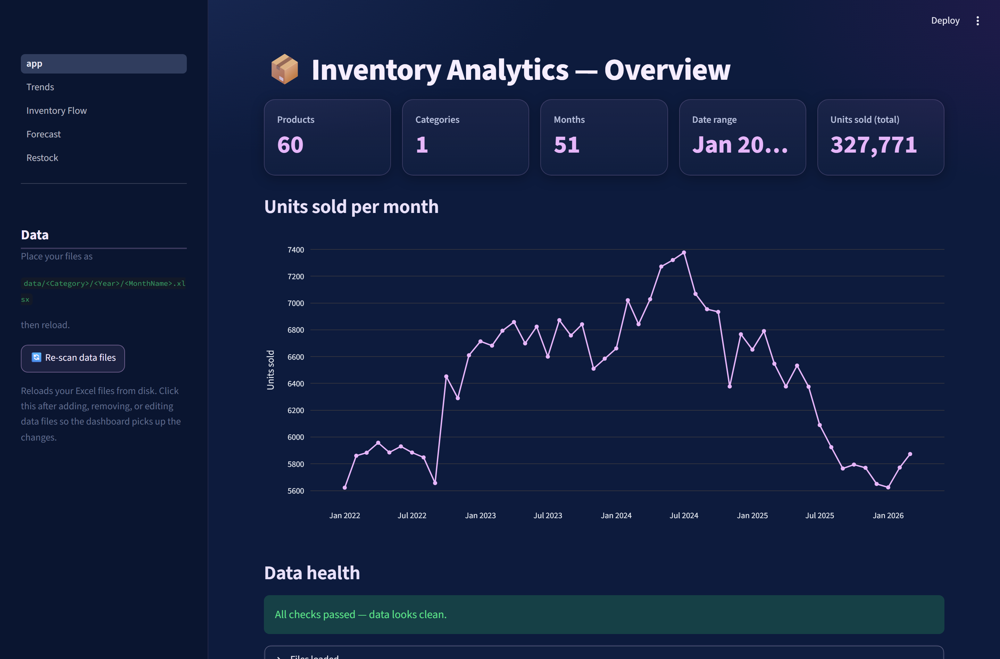
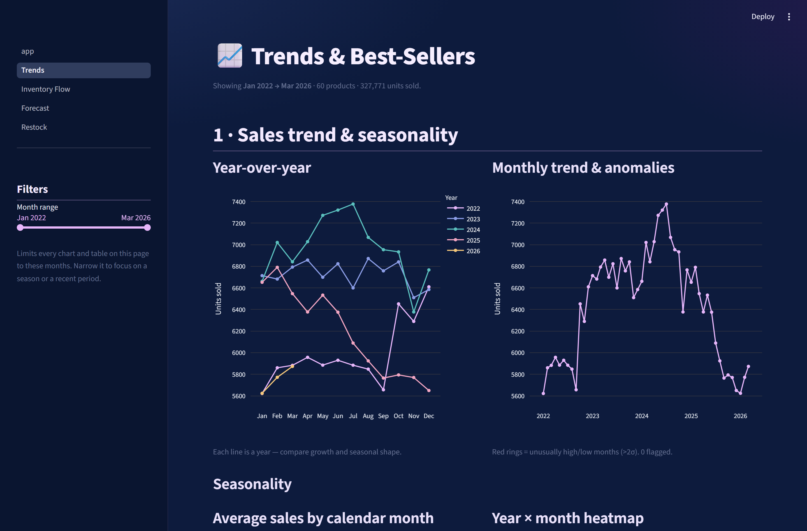
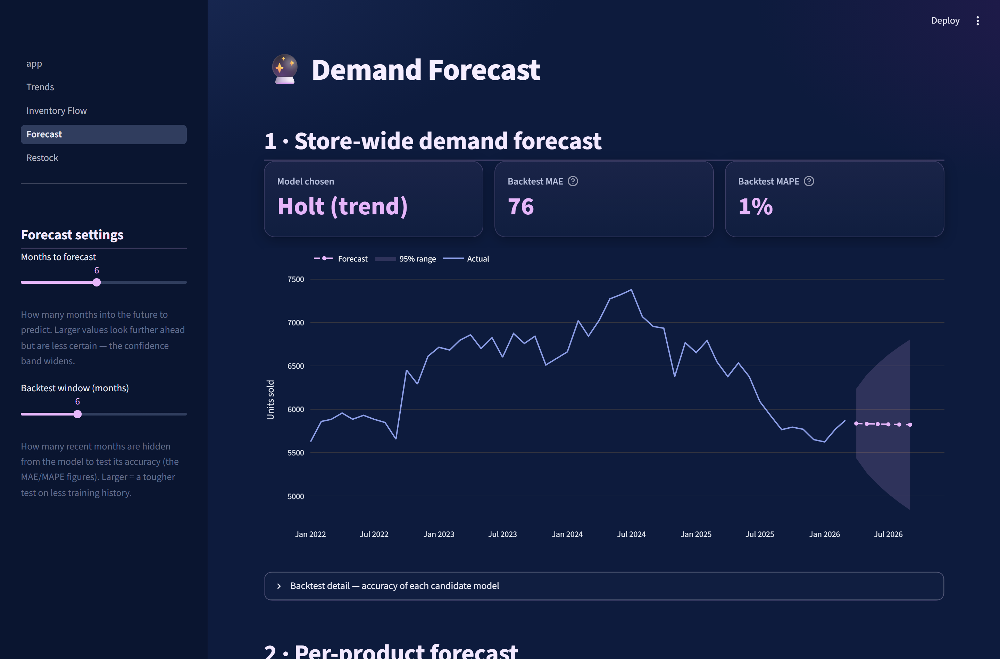
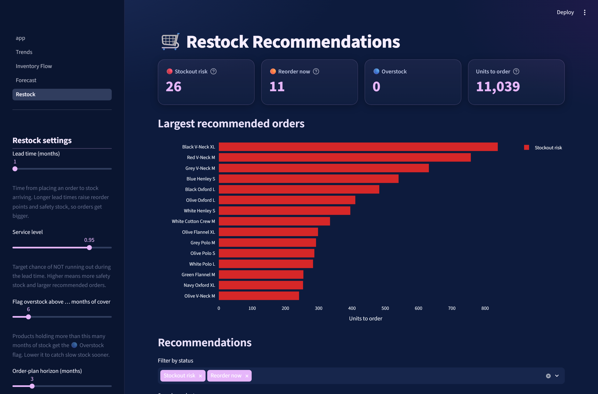
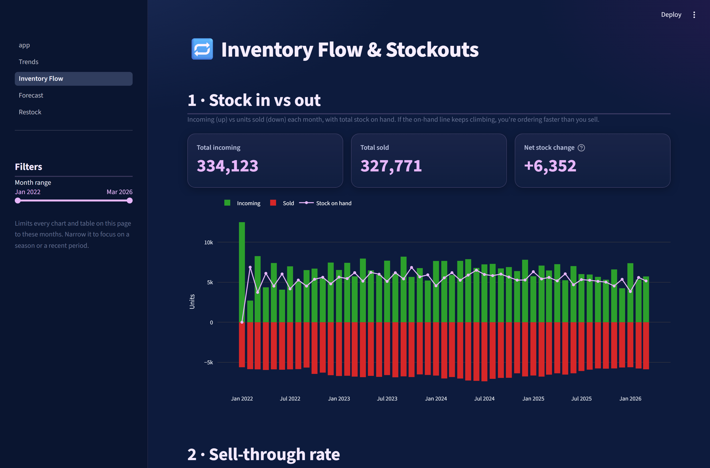

# 📦 Inventory Analytics Dashboard

I built this dashboard to help a wholesale clothing business understand their stock. Every month they record how much of each product they have, how much arrived, and how much sold, all in Excel files. This app reads those files and turns them into clear answers: what is selling, what is not, how much they will likely sell next, and what they should order.

It runs on your own computer as a web page. There is no cloud and no account. You can put in your own data in the same folder layout and everything updates on its own.

I built it with Python, pandas, statsmodels, Plotly and Streamlit, and I packaged it as a Windows app so someone who does not code can open it with a double click.

Every number in the screenshots and in this repo comes from a made up demo dataset. No real business data is included.

## Screenshots

**Overview and data health**



**Trends and best sellers**



**Demand forecast**



**Restock recommendations**



**Inventory flow and stockouts**



## What this project shows

I wanted this to show that I can take messy data all the way to a finished tool.

* Cleaning real data. The app reads about 50 Excel files into one tidy table and checks it for problems. It caught a real one: partway through the data, quantities were saved as text like "55 PCS", which had quietly hidden about 38% of the sales until I found it.
* Linking products across a naming change. The product names were written two different ways over time, so the same item looked like two products. I match them by the style code inside the name so their full history stays together.
* Forecasting demand. For each product the app picks the best forecasting method on its own and then tests how accurate it is on recent months it was not shown.
* Saying what to do next. It works out safety stock, reorder points, and how much to order in each of the coming months, and it flags items about to run out or sitting unsold.
* Shipping a real tool. It has a clean set of pages and a Windows app, so anyone can load their own data and use it without installing anything.

## How to run it

There are two ways.

### The easy way (no Python needed)

1. Get the InventoryDashboard folder (built with build_exe.bat, see below).
2. Double click InventoryDashboard.exe.
3. It opens in your browser at http://localhost:8501. A small window shows up first. Keep it open while you use the app and close it to stop.

To use your own data, replace the folders inside the data folder next to the app and open it again.

### From the source code

You need Python 3.11 or newer.

1. Install Python from https://www.python.org/downloads/ and tick "Add Python to PATH".
2. Double click start.bat. It sets everything up, makes demo data if you have none, and opens the dashboard.

Or run it by hand:

```
python -m venv .venv
.venv\Scripts\activate
pip install -r requirements.txt
python scripts/make_sample_data.py
streamlit run app.py
```

## Your data

Put your files under a data folder like this:

```
data/
  Shirts/
    2022/
      August.xlsx
      September.xlsx
    2023/
    2026/
      January.xlsx
      February.xlsx
      March.xlsx
```

One folder for each product category, one folder for each year, and one Excel file for each month named after the month.

Each file has one row per product with these columns:

* Item: the product name
* Stock Available: units on hand at the start of the month
* Incoming: units that arrived during the month
* Outgoing: units sold during the month
* Stock Remaining: units left at the end of the month

The names are matched loosely, so "Stock Remaining" and "StockRemaining" both work, and quantities like "55 PCS" are read as numbers. Products can come and go from month to month.

The repo also includes a sample_data folder with a demo set so you can see the format.

## The pages

* Overview: headline numbers, a sales chart, and a data health panel that flags anything odd.
* Trends: sales over the years, seasonality, best sellers, stock turnover, and dead stock.
* Inventory Flow: stock in versus out each month, the sell through rate, and items that ran out.
* Forecast: a store wide forecast with an accuracy score, plus a forecast for each product.
* Restock: safety stock, reorder points, a clear list of what to order, and a plan for the coming months.

Every table can be downloaded as a CSV file.

## Settings

Open config.yaml to change things like how many months to forecast, the restock lead time, and the service level. You do not need to touch the code.

## Building the Windows app

On a computer that already has the project set up, double click build_exe.bat. It builds the app and copies your data and settings next to it. The result is in dist/InventoryDashboard, and you can zip that folder to share it.

## Project layout

```
app.py            the Overview page and app entry point
pages/            the Trends, Inventory Flow, Forecast and Restock pages
src/              the data loading, checks, metrics, forecasting and restock logic
config.yaml       settings you can change
sample_data/      a demo dataset
requirements.txt  the Python packages it needs
start.bat         one click run from the source
build_exe.bat     builds the Windows app
```
